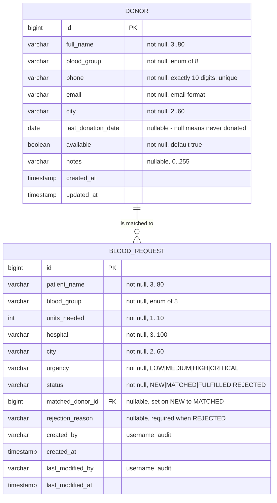

# Data Model and API Specification

Ayush Mayekar · 23102A0018 · Task 3 deliverable

Base URL in the demonstration environment: `http://localhost:9090`
All `/api/**` endpoints consume and produce `application/json`. All require authentication except
where stated; the demonstration uses HTTP Basic for the API and form login for the UI.

---

## 1. Data model



### 1.1 Enumerations

| Enum | Values | Behaviour carried by the enum |
|---|---|---|
| `BloodGroup` | `O_NEG O_POS B_NEG B_POS A_NEG A_POS AB_NEG AB_POS` (displayed `O- O+ B- B+ A- A+ AB- AB+`) | `canReceiveFrom(BloodGroup donor)` implements the 8 × 8 compatibility matrix (SRS §3.2) |
| `RequestStatus` | `NEW MATCHED FULFILLED REJECTED` | `allowedNext()` returns the legal successor states; `isTerminal()` is true for `FULFILLED` and `REJECTED` |
| `Urgency` | `LOW MEDIUM HIGH CRITICAL` | ordering used for display priority on the dashboard |

### 1.2 Derived (not stored) values

| Value | Definition |
|---|---|
| `eligible` | `lastDonationDate == null || DAYS.between(lastDonationDate, today) >= 90` |
| `nextEligibleDate` | `lastDonationDate == null ? today : lastDonationDate.plusDays(90)` |
| `matching` (for a request) | `compatible && eligible && available` |

Eligibility is deliberately **not** a stored column: storing it would require a nightly job and
would be wrong the moment the clock passed midnight. It is computed on read.

### 1.3 Seed data (`data.sql`, loaded only into an empty database)

16 donors spread across all eight blood groups and four cities (Mumbai, Thane, Navi Mumbai, Pune),
with a deliberate mix of last-donation dates — some never donated, some donated 10/45/89/90/120
days ago — so that the eligibility boundary is visible in the UI during the demonstration.
3 blood requests, one in each of `NEW`, `MATCHED` and `FULFILLED`.

### 1.4 Demonstration users

| Username | Password | Role |
|---|---|---|
| `admin` | `Admin@123` | `ADMIN` |
| `staff` | `Staff@123` | `STAFF` |
| `donor` | `Donor@123` | `DONOR` (bound to seed donor id 1) |

Passwords are BCrypt-hashed at startup and come from configuration, not from source code
(NFR-06). They are demonstration credentials for a locally deployed application only.

---

## 2. Web (UI) endpoints

| Method | Path | Role | Purpose |
|---|---|---|---|
| GET | `/login` | anonymous | Login form |
| POST | `/login` | anonymous | Authenticate (CSRF-protected) |
| POST | `/logout` | authenticated | Sign out |
| GET | `/` , `/dashboard` | ADMIN, STAFF | Summary dashboard (counts, shortage flags) |
| GET | `/donors` | ADMIN, STAFF | Donor list with `group`, `city`, `availableOnly` filters |
| GET | `/donors/new` | ADMIN, STAFF | Empty donor form |
| POST | `/donors` | ADMIN, STAFF | Create donor |
| GET | `/donors/{id}` | ADMIN, STAFF | Donor detail |
| GET | `/donors/{id}/edit` | ADMIN, STAFF | Pre-filled donor form |
| POST | `/donors/{id}` | ADMIN, STAFF | Update donor |
| GET | `/requests` | ADMIN, STAFF | Request list with `status`, `group` filters |
| GET | `/requests/new` | ADMIN, STAFF | Empty request form |
| POST | `/requests` | ADMIN, STAFF | Create request (status `NEW`) |
| GET | `/requests/{id}` | ADMIN, STAFF | Request detail **including the ranked match shortlist** |
| POST | `/requests/{id}/match` | ADMIN, STAFF | Assign donor `donorId` → `MATCHED` |
| POST | `/requests/{id}/fulfil` | **ADMIN only** | → `FULFILLED`, stamps donor's donation date |
| POST | `/requests/{id}/reject` | **ADMIN only** | → `REJECTED` with `reason` |
| GET | `/me` | DONOR | Own profile and donation history |
| POST | `/me/availability` | DONOR | Toggle own availability |

## 3. REST API endpoints

### Donors

| Method | Path | Role | Request body | Success | Errors |
|---|---|---|---|---|---|
| GET | `/api/donors` | ADMIN, STAFF | — (query: `group`, `city`, `availableOnly`, `page`, `size`) | `200` page of `DonorView` | `401` |
| POST | `/api/donors` | ADMIN, STAFF | `DonorForm` | `201` + `Location`, `DonorView` | `400` validation, `409` duplicate phone |
| GET | `/api/donors/{id}` | ADMIN, STAFF | — | `200 DonorView` | `404` |
| PUT | `/api/donors/{id}` | ADMIN, STAFF | `DonorForm` | `200 DonorView` | `400`, `404` |
| PATCH | `/api/donors/{id}/availability` | ADMIN, STAFF, own DONOR | `{"available": false}` | `200 DonorView` | `403` other donor's record |
| GET | `/api/donors/eligible` | ADMIN, STAFF | query `group` | `200` list of matching donors | `400` bad group |

### Blood requests

| Method | Path | Role | Request body | Success | Errors |
|---|---|---|---|---|---|
| GET | `/api/requests` | ADMIN, STAFF | query `status`, `group` | `200` list of `RequestView` | `401` |
| POST | `/api/requests` | ADMIN, STAFF | `RequestForm` | `201 RequestView` (status `NEW`) | `400` |
| GET | `/api/requests/{id}` | ADMIN, STAFF | — | `200 RequestView` | `404` |
| **GET** | **`/api/requests/{id}/matches`** | ADMIN, STAFF | — | `200` ranked `MatchView[]` | `404` |
| POST | `/api/requests/{id}/match` | ADMIN, STAFF | `{"donorId": 7}` | `200 RequestView` (`MATCHED`) | `409` illegal transition, `422` donor not a valid match |
| POST | `/api/requests/{id}/fulfil` | **ADMIN** | — | `200 RequestView` (`FULFILLED`) | `403` wrong role, `409` not `MATCHED` |
| POST | `/api/requests/{id}/reject` | **ADMIN** | `{"reason": "..."}` | `200 RequestView` (`REJECTED`) | `400` missing reason, `403`, `409` terminal |

### Dashboard and operations

| Method | Path | Role | Success |
|---|---|---|---|
| GET | `/api/dashboard` | ADMIN, STAFF | `200 DashboardView` |
| GET | `/actuator/health` | **anonymous** | `200 {"status":"UP"}` |
| GET | `/actuator/info` | ADMIN | `200` build and version information |

---

## 4. Representations

```jsonc
// DonorView
{
  "id": 7,
  "fullName": "Rohit Deshmukh",
  "bloodGroup": "O-",
  "phone": "9820012345",
  "email": "rohit.deshmukh@example.com",
  "city": "Thane",
  "lastDonationDate": "2026-05-02",
  "available": true,
  "eligible": true,              // derived
  "nextEligibleDate": "2026-07-31" // derived
}
```

```jsonc
// RequestForm  (POST /api/requests)
{
  "patientName": "Meera Joshi",
  "bloodGroup": "B+",
  "unitsNeeded": 2,
  "hospital": "Civil Hospital",
  "city": "Thane",
  "urgency": "HIGH"
}
```

```jsonc
// RequestView
{
  "id": 14,
  "patientName": "Meera Joshi",
  "bloodGroup": "B+",
  "unitsNeeded": 2,
  "hospital": "Civil Hospital",
  "city": "Thane",
  "urgency": "HIGH",
  "status": "MATCHED",
  "matchedDonor": { "id": 7, "fullName": "Rohit Deshmukh", "bloodGroup": "O-" },
  "rejectionReason": null,
  "allowedNext": ["FULFILLED", "REJECTED"],   // drives the UI buttons
  "createdBy": "staff",
  "createdAt": "2026-10-02T11:04:18",
  "lastModifiedBy": "staff",
  "lastModifiedAt": "2026-10-02T11:09:02"
}
```

```jsonc
// MatchView  (GET /api/requests/{id}/matches) — already ranked
[
  { "donorId": 4, "fullName": "Sneha Patil",  "bloodGroup": "B+", "city": "Thane",
    "exactGroupMatch": true,  "sameCity": true,  "daysSinceLastDonation": 142, "rank": 1 },
  { "donorId": 7, "fullName": "Rohit Deshmukh","bloodGroup": "O-", "city": "Thane",
    "exactGroupMatch": false, "sameCity": true,  "daysSinceLastDonation": 160, "rank": 2 },
  { "donorId": 11,"fullName": "Imran Shaikh", "bloodGroup": "O+", "city": "Pune",
    "exactGroupMatch": false, "sameCity": false, "daysSinceLastDonation": 400, "rank": 3 }
]
```

```jsonc
// DashboardView
{
  "donorsByGroup":   { "O-": 2, "O+": 3, "B-": 1, "B+": 2, "A-": 1, "A+": 3, "AB-": 1, "AB+": 1 },
  "eligibleByGroup": { "O-": 1, "O+": 3, "B-": 1, "B+": 1, "A-": 1, "A+": 2, "AB-": 0, "AB+": 1 },
  "requestsByStatus":{ "NEW": 2, "MATCHED": 1, "FULFILLED": 4, "REJECTED": 1 },
  "shortages": ["AB-"],          // open requests but zero matching donors
  "totalDonors": 14,
  "openRequests": 3
}
```

```jsonc
// Error body — identical shape for every failure
{
  "timestamp": "2026-10-06T14:22:07",
  "status": 409,
  "error": "IllegalTransition",
  "message": "Request 14 cannot move from NEW to FULFILLED",
  "path": "/api/requests/14/fulfil",
  "fieldErrors": []              // populated for 400 validation failures
}
```

---

## 5. Status-code contract

| Code | Meaning in this API | Example trigger |
|---|---|---|
| 200 | Success | Any successful read or transition |
| 201 | Created | `POST /api/donors`, `POST /api/requests` |
| 400 | Request body or parameters failed validation | 9-digit phone, `unitsNeeded = 0`, missing rejection reason |
| 401 | Not authenticated | Any `/api/**` call with no credentials |
| 403 | Authenticated but the role is not permitted | `staff` calling `/fulfil`; `donor` editing another donor |
| 404 | Unknown identifier | `/api/requests/9999` |
| 409 | Legal request, illegal state | `NEW → FULFILLED`; transition out of a terminal state; duplicate phone |
| 422 | Semantically invalid business input | Matching a donor who is incompatible or ineligible |
| 500 | Unexpected failure | Database unavailable (also turns `/actuator/health` to `DOWN`) |

Error codes 403 and 409 are the two the examiner is most likely to ask about: 403 proves
**authorisation** is enforced server-side (NFR-07), and 409 proves the **state machine** is
enforced in the service layer rather than by hiding buttons (FR-18).

---

## 6. Example calls used in the demonstration

```bash
# health (no credentials needed - this is what Docker and Ansible probe)
curl -s http://localhost:9090/actuator/health

# ranked match shortlist for request 1
curl -s -u staff:Staff@123 http://localhost:9090/api/requests/1/matches | jq .

# role enforcement: staff may NOT fulfil -> 403
curl -s -o /dev/null -w '%{http_code}\n' -X POST \
     -u staff:Staff@123 http://localhost:9090/api/requests/1/fulfil

# illegal transition: admin fulfilling a NEW request -> 409
curl -s -X POST -u admin:Admin@123 \
     http://localhost:9090/api/requests/2/fulfil | jq '.status, .error'

# dashboard snapshot
curl -s -u admin:Admin@123 http://localhost:9090/api/dashboard | jq .
```

These exact commands are wrapped in `scripts/health-check.sh`, so the same assertions run in the
Jenkins pipeline, in the Ansible health check and by hand during the viva.
