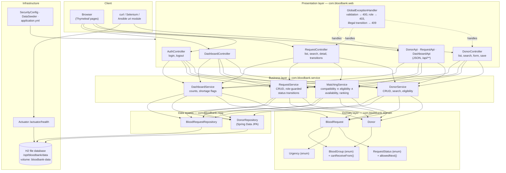
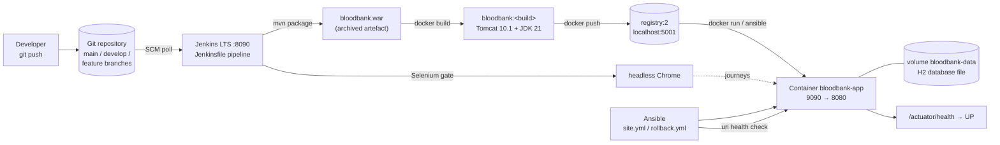
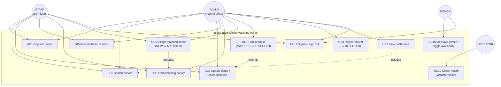

# Architecture — Containerized Blood Bank Donor Matching Portal

Ayush Mayekar · 23102A0018 · Task 3 deliverable · 30 September 2026

---

## 1. Technology stack, and why each piece was chosen

| Layer | Choice | Why this and not the alternative |
|---|---|---|
| Language / runtime | **Java 21 (LTS)** | Spring Boot 3 requires Java 17+; JDK 21 is already installed on the build host and is the same runtime used inside the image, so "works on my machine" and "works in the container" are the same JVM |
| Framework | **Spring Boot 3.3** | Gives dependency injection, validation, security, JPA and Actuator health endpoints out of one dependency set; Actuator is what the Docker `HEALTHCHECK` and the Ansible health check consume |
| Web layer | **Spring MVC + Thymeleaf** (server-rendered) | A single artefact serves UI and API, so one WAR is the whole deployable. A separate React front end would have added a second build, a second container and no marks |
| Styling | **Bootstrap 5, vendored into `src/main/resources/static`** | The demonstration must work with no internet; a CDN link would make the UI collapse offline |
| Persistence | **Spring Data JPA + H2 in file mode** | Zero external service to install, yet real SQL and real persistence. The file lives on a Docker **named volume**, which is exactly what makes "data survives container replacement" demonstrable in Task 12 |
| Security | **Spring Security**, form login, BCrypt, in-memory users | Three roles are needed to demonstrate the role-based workflow; a user-management CRUD screen is not in scope |
| Build | **Maven 3.10** | Required by the task sheet. Surefire for unit tests, Failsafe for Selenium, so a slow UI suite never blocks the fast feedback loop |
| Packaging | **WAR (`bloodbank.war`)** | The task sheet names Tomcat as the deployment target. Spring Boot's WAR is also executable, so the *same file* runs via `java -jar` locally and as a Tomcat webapp in the image — no second build profile |
| Servlet container | **Tomcat 10.1 (jdk21-temurin image)** | Jakarta EE 10 namespace, matching Spring Boot 3. Nginx was the other allowed option but it cannot host a WAR, so it would have meant adding a reverse proxy with nothing behind it |
| Containerisation | **Docker, multi-stage build** | Stage 1 builds with Maven and caches dependencies; stage 2 is just Tomcat plus the WAR, which keeps the runtime image free of the toolchain |
| Registry | **`registry:2` on `localhost:5001`** | Versioned images without credentials or internet at demo time; the Docker Hub commands are documented in `docs/12-jenkins-docker-cd.md` as the alternative |
| CI/CD | **Jenkins LTS**, freestyle job + declarative `Jenkinsfile` | Required by the task sheet. The freestyle job satisfies Task 7; the Jenkinsfile satisfies pipeline-as-code from Task 8 onwards |
| UI testing | **Selenium 4 + JUnit 5**, headless Chrome | Selenium 4's Selenium Manager resolves the matching chromedriver for the installed Chrome, so no driver binary is committed and no version pinning rots |
| Configuration management | **Ansible** with `community.docker` | YAML playbooks are idempotent by construction, which is what Task 14 must prove. Puppet was the other allowed option but needs an agent and is awkward on Apple Silicon |
| Database migration | Hibernate DDL + `data.sql` seed | Flyway/Liquibase would be correct for production and is listed as a future item; for a frozen MVP schema it would be ceremony without benefit |

### Rejected alternatives, briefly

- **Spring Boot fat JAR only** — would not satisfy "Tomcat deployment target".
- **PostgreSQL container** — adds a second container, a second health check and a network to the
  MVP without teaching anything the pipeline does not already demonstrate. Listed as FE-10.
- **GitHub Actions** — the subject specifies Jenkins; Actions would also not run offline.
- **Kubernetes** — out of syllabus; Docker + Ansible is what Tasks 11–14 ask for.

---

## 2. Layered architecture



**The rule that keeps this testable:** every business rule — compatibility, eligibility, ranking,
transition legality, role permission — lives in the **business layer** or in an **enum method**.
Controllers only bind input, call one service method and choose a view. That is why 90 % of the
requirements can be proved by fast JUnit tests and Selenium only has to cover five journeys.

---

## 3. Deployment architecture



| Concern | Decision |
|---|---|
| Deployment strategy | **Recreate** — stop and remove the old container, start a new one from the new image tag. Chosen because it is what the syllabus asks for and because the named volume makes it safe. Blue-green is listed as a future item |
| Rollback | Re-run deployment pinned to the previous image tag (`ansible/rollback.yml`); images are immutable and retained in the registry, so rollback never rebuilds |
| State | All state in volume `bloodbank-data`; the container is disposable |
| Configuration | Environment variables injected at `docker run` / by Ansible: `SPRING_PROFILES_ACTIVE`, `BLOODBANK_DB_PATH`, `SERVER_PORT`; nothing environment-specific is baked into the image |
| Secrets | Demo credentials come from configuration, not source; Docker-registry and Docker Hub credentials live in Jenkins credential bindings, never in the `Jenkinsfile` |
| Health | Spring Actuator → container `HEALTHCHECK` → Ansible `uri` assertion → Jenkins post-deploy check. One signal, consumed at four levels |
| Ports | Jenkins 8090 · application 9090 → container 8080 · registry 5001. Asserted by `scripts/preflight.sh` because host 8080 is occupied |

---

## 4. Package structure

```
com.bloodbank
├── BloodBankApplication.java        # @SpringBootApplication + SpringBootServletInitializer (WAR)
├── config/
│   ├── SecurityConfig.java          # form login, BCrypt, role rules, /actuator/health open
│   └── DataSeeder.java              # demo donors and requests on an empty database
├── domain/
│   ├── Donor.java                   # entity + isEligible(LocalDate) + nextEligibleDate()
│   ├── BloodRequest.java            # entity + audit fields
│   ├── BloodGroup.java              # enum of 8 groups + canReceiveFrom(BloodGroup)
│   ├── RequestStatus.java           # enum + allowedNext() + isTerminal()
│   └── Urgency.java                 # enum LOW/MEDIUM/HIGH/CRITICAL
├── repo/
│   ├── DonorRepository.java         # derived queries + search specification
│   └── BloodRequestRepository.java
├── service/
│   ├── DonorService.java
│   ├── MatchingService.java         # the core algorithm
│   ├── RequestService.java          # role-guarded transitions
│   └── DashboardService.java
└── web/
    ├── DonorController.java  RequestController.java
    ├── DashboardController.java  AuthController.java
    ├── api/ DonorApi.java  RequestApi.java  DashboardApi.java
    └── GlobalExceptionHandler.java
```

Tests mirror the same packages: `src/test/java` for unit tests (Surefire) and `src/it/java` for
Selenium journeys (Failsafe).

---

## 5. Matching algorithm (the system's core logic)

```
input : request R (group g, city c), today's date T
output: donors ranked best-first

1  candidates ← all donors
2  keep d where  g.canReceiveFrom(d.bloodGroup)          -- compatibility  (FR-14)
3  keep d where  d.available = true                      -- availability   (FR-13)
4  keep d where  d.lastDonationDate is null
                 or daysBetween(d.lastDonationDate, T) >= 90   -- eligibility (FR-08)
5  sort by
     (a) d.bloodGroup = g        descending   -- exact group first, preserve O− stock
     (b) d.city = c              descending   -- same city first
     (c) days since last donation descending  -- fairest rotation of donors
     (d) d.fullName              ascending    -- deterministic for tests
6  return
```

Step 5(a) is a deliberate clinical-stewardship decision: a universal O− donor should not be spent
on an O+ patient while an O+ donor is available. Step 5(c) spreads the load across the register
instead of repeatedly calling the same people. Step 5(d) exists purely so the unit tests are
deterministic.

Complexity is O(n log n) in the number of donors, with n ≈ hundreds — hence NFR-01's 2-second
budget is met with a wide margin (measured in `MatchingPerformanceTest`).

---

## 6. Use-case view



`UC7 extends UC3` because fulfilling a request also records the donation date on the matched donor,
which is what starts that donor's 90-day ineligibility window (FR-20).

---

## 7. Cross-cutting concerns

| Concern | How it is handled |
|---|---|
| Validation | Bean Validation annotations on entities and form objects; `GlobalExceptionHandler` turns violations into field errors (HTML) or a 400 JSON body (API) |
| Authorisation | `SecurityConfig` for URL-level rules **plus** an explicit role check inside `RequestService` for every transition, so the API cannot bypass the UI's restrictions (NFR-07) |
| Error semantics | 400 validation · 403 wrong role · 404 unknown id · 409 illegal state transition. The API and the UI share the same handler |
| Auditing | `createdBy`, `createdAt`, `lastModifiedBy`, `lastModifiedAt` on `BloodRequest`; every transition stamps the acting user (NFR-15) |
| Transactions | Service methods are `@Transactional`; the fulfil transition updates the request and the donor in one transaction so a donation date can never be recorded without the request advancing |
| Observability | Actuator health and info; container `HEALTHCHECK`; Jenkins publishes test trends per build |
| Configuration | `application.yml` with environment-variable overrides; no host, port or path literal in Java code |
