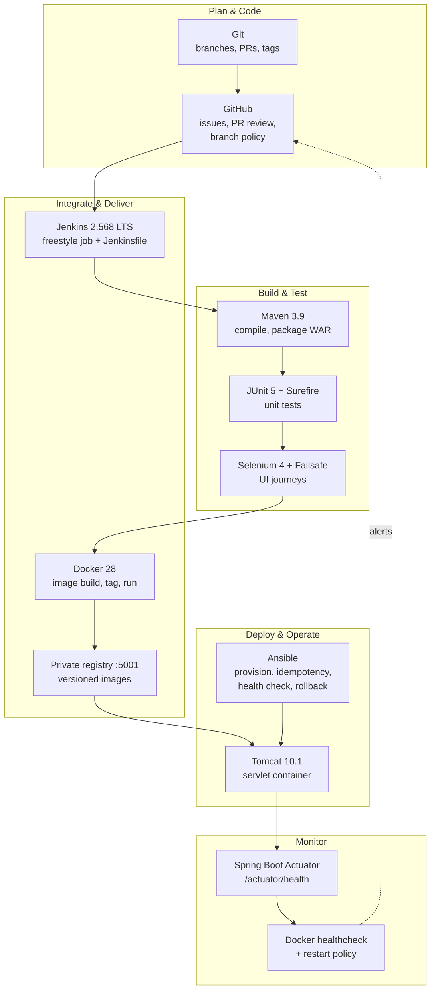
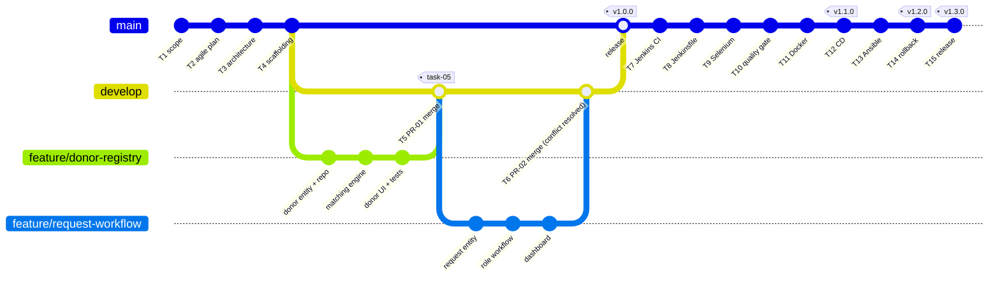
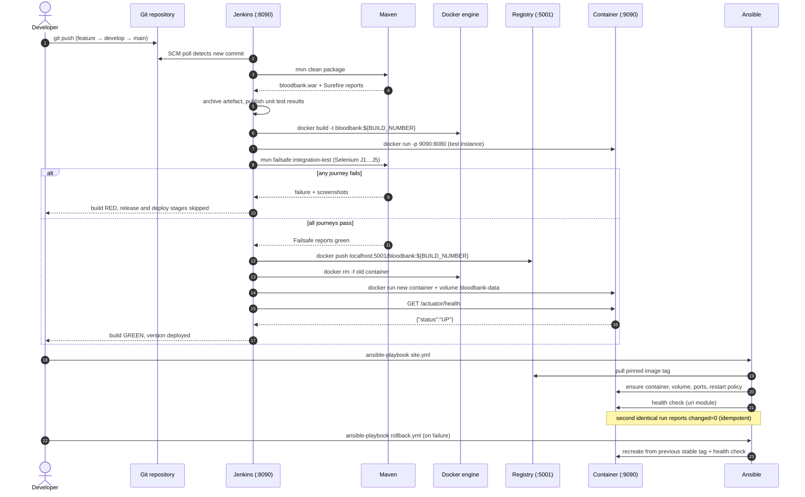
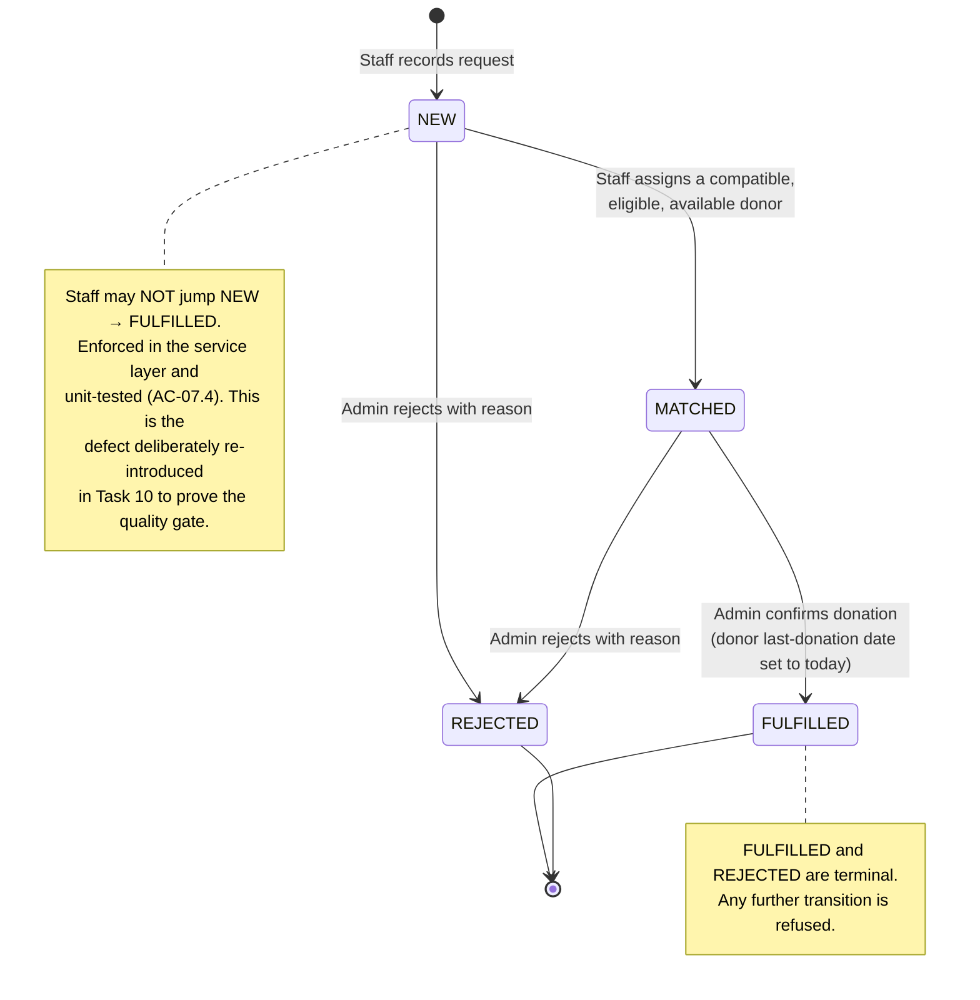
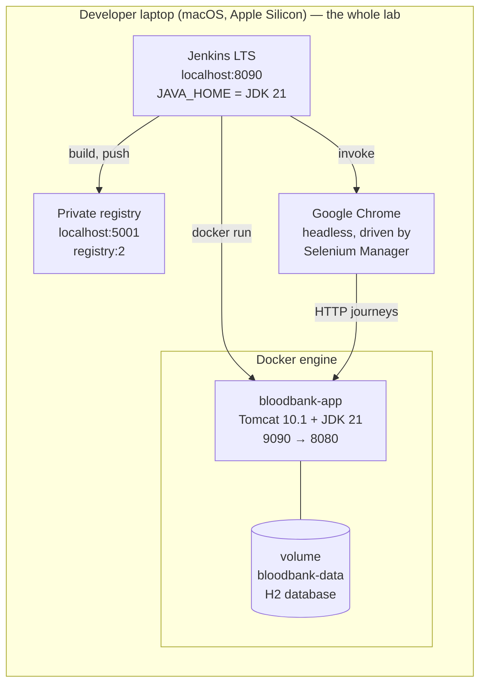

# DevOps Lifecycle Workflow — Blood Bank Donor Matching Portal

Ayush Mayekar · 23102A0018 · Task 2 deliverable

All diagrams are Mermaid, so they render directly on GitHub and in most IDE previewers. To export
PNGs for the report: `npx -y @mermaid-js/mermaid-cli -i docs/diagrams/devops-lifecycle.md -o out.png`

---

## 1. The lifecycle as implemented (development → operations)

```mermaid
flowchart LR
    subgraph DEV["Development"]
        P["PLAN<br/>backlog item, issue,<br/>feature/&lt;slug&gt; branch"]
        C["CODE<br/>unit test red → green,<br/>conventional commit"]
    end
    subgraph CI["Continuous Integration — Jenkins"]
        B["BUILD<br/>mvn clean package<br/>→ bloodbank.war"]
        T1["UNIT TEST<br/>Surefire<br/>matching, eligibility,<br/>workflow guards"]
        PK["PACKAGE<br/>Docker image<br/>bloodbank:${BUILD_NUMBER}"]
    end
    subgraph CT["Continuous Testing — quality gate"]
        D1["DEPLOY TO TEST<br/>container on :9090"]
        T2{"UI TEST<br/>Selenium journeys<br/>J1 … J5"}
    end
    subgraph CD["Continuous Delivery / Deployment"]
        R["RELEASE<br/>push versioned image<br/>→ registry :5001"]
        DP["DEPLOY<br/>recreate container<br/>+ named volume"]
    end
    subgraph OPS["Operations"]
        O["OPERATE<br/>Ansible provisioning,<br/>restart policy"]
        M["MONITOR<br/>/actuator/health,<br/>container healthcheck,<br/>Jenkins trend"]
    end

    P --> C --> B --> T1 --> PK --> D1 --> T2
    T2 -- pass --> R --> DP --> O --> M
    T2 -- fail --> FB["FEEDBACK<br/>build red, deploy skipped,<br/>screenshot attached"]
    M --> FB
    FB --> P

    classDef gate fill:#ffe0e0,stroke:#c0392b,stroke-width:2px
    classDef dev fill:#e8f0fe,stroke:#3367d6
    classDef ops fill:#e6f4ea,stroke:#1e8e3e
    class T2 gate
    class P,C dev
    class O,M ops
```

**The single most important arrow** is `T2 -- fail --> FEEDBACK`: because the Selenium stage sits
*before* the release and deploy stages, a failing user journey cannot reach a running container.
That is the quality gate demonstrated in Task 10.

---

## 2. Tool-chain view — which tool owns which phase

---

## 3. Branching and promotion model

---

## 4. End-to-end pipeline sequence (commit to running container)

---

## 5. Request status workflow (the role-based gate inside the application)

---

## 6. Environments

Port 8080 on this host is already in use by an unrelated service, which is why Jenkins listens on
**8090** and the application is published on **9090**. `scripts/preflight.sh` asserts that 8090,
9090 and 5001 are free (or owned by this project) before anything starts.
